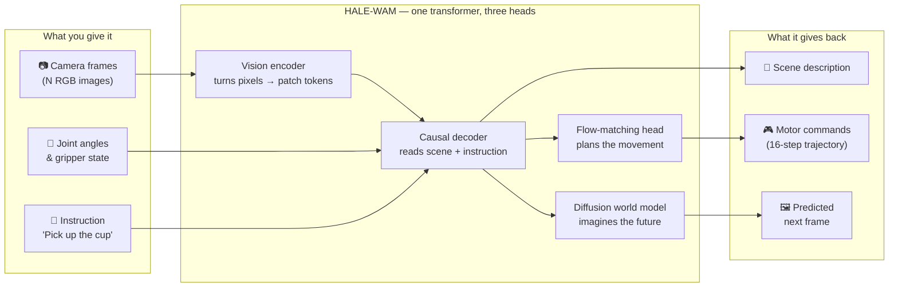

<div align="center">

# Halo-WAM

### A compact Vision-Language-Action model with an integrated world model

*Perceive · Reason · Act · Imagine*

[](https://github.com/basaanithanaveenkumar/HALE-WAM)
[](https://basaanithanaveenkumar.github.io/HALE-WAM/)
[](https://github.com/basaanithanaveenkumar/HALE-WAM/blob/main/paper/main.tex)
[](LICENSE)
[](https://www.python.org/)
[](https://pytorch.org/)

</div>

---

Halo-VLA is a single unified model that handles **language grounding**, **robot action prediction**, and **future-frame imagination** in one forward pass. It takes camera frames and proprioceptive state as input, generates a natural-language description of the scene, predicts a continuous action trajectory, and synthesises what the world will look like next — all jointly trained end-to-end.

<div align="center">

### Checkpoint — epoch 24 000 · step 24 000

| Training visualisation | Diffusion (noise → frame) |
|:---:|:---:|
|  |  |
| Context scroll → text reveal → action trajectory → predicted future frames | DiT velocity-field denoising: pure noise → predicted RGB frame |

</div>

---

## How it works

One transformer reads your robot's camera frames, its joint state, and a language instruction — then writes back three things at the same time: a text description of the scene, a 16-step action trajectory, and a prediction of what the scene will look like after the move.



> **Why predict the future frame?** A model that can also imagine what it expects to see is easier to debug and can learn from video without needing action labels.

---

## Architecture

### Key components

| Module | What it does |
|---|---|
| **ViT** | 4-layer Vision Transformer encodes each frame into patch embeddings |
| **Decoder Transformer** | 8-layer causal transformer with DeepSeekMoE FFN; fuses vision, state and text |
| **Flow Matching Action Decoder** | Predicts robot trajectories via ODE integration; learns the velocity field `v*(x,t) = x₁ − x₀` |
| **DiT World Model** | Diffusion Transformer predicts future RGB frames conditioned on world-action tokens and text embeddings |
| **ALBERT-style factored embeddings** | Vocabulary embedding bottlenecked through a 128-dim projection; cuts embedding memory ~10× vs full tables |

### Flow matching — how action prediction works

```
Training                              Inference
──────────────────────────────────    ──────────────────────────
x₀ ~ N(0, I)  (noise)                x  = x₀  (start from noise)
x₁ = target action chunk             dt = 1 / num_steps
t  ~ U(0, 1)                         for i in range(num_steps):
x_t = (1-t)·x₀ + t·x₁                   v = DiT(x, t, cond)
v*  = x₁ − x₀                            x = x + v · dt
loss = MSE(DiT(x_t, t, cond), v*)    return x  # ≈ clean action chunk
```

The same formulation drives the **DiT world model** — it learns to denoise random noise into a predicted future video frame, conditioned on the decoded world-action tokens.

### DiT world model — per-frame conditioning pipeline

Each predicted future frame gets a **unique conditioning vector** built from four stacked signals:

```
world_action_tokens[frame_offset + i]
        │
        ▼
  Cross-Attention ←── text embeddings (keys / values)
        │
        + sinusoidal frame-index embedding  (frame i vs frame j always differ)
        │
        + context_frame_enc(last_seen_frame)  (SVD-style pixel-level anchor)
        │
        ▼
  CFG dropout (p=0.1 during training)  →  cfg_null_context
        │
        ▼
  DiT adaLN: c = sigmoid(W·ctx) · t_emb + ctx_emb
```

At inference the DiT integrates via **Heun's 2nd-order ODE** (halves truncation error vs Euler) with optional **Classifier-Free Guidance** for sharper predictions.

Training uses three auxiliary losses on top of the flow-matching MSE to combat blurring:
- **VGG perceptual loss** — feature-space MSE at relu1_2 and relu2_2
- **SSIM loss** — structural similarity on the estimated clean frame
- **Temporal smoothness** — L2 between consecutive predicted velocity fields

---

## Project structure

```
HALE-WAM/
├── src/Halo_VLA/                  # library (import roots: repo root and src/Halo_VLA, see docs/getting-started.md)
│   ├── models/                    # HaloVLM, vit/, transformer/, moe/, qformer/, gated_cross_attention/,
│   │                              #   image_proj/ (IMAGE_PROJECTORS), vision_encoders/ (VISION_ENCODERS),
│   │                              #   DiT/, flow_action_decoder/, video_vae/, state_encoder.py
│   ├── dual_system/               # presets (DUAL_SYSTEM_PRESETS), latent/ (LATENT_EXTRACTORS),
│   │                              #   system1/ (SYSTEM1_POLICIES), model/, system2.py, controller.py
│   ├── training/                  # DDPSession, CheckpointManager, TRAIN_DATASETS, steps, Ray / WebDataset CLI
│   ├── rl/                        # GRPO, DPO, REINFORCE, Dreamer, actor_critic/, rewards/
│   ├── metrics/                   # action/, generation/, policy/ evaluation metrics
│   ├── visualization/             # frames, action plots, DiT GIFs, videos
│   ├── profiling/                 # architecture-equivalent stubs, PROFILE_COMPONENTS
│   ├── deploy/                    # hale-wam-deploy adapters (HALO_VLA_ADAPTERS) and export graphs
│   └── exceptions/                # HaloVLAError hierarchy rooted in hale_core.HaleCoreError
├── config/                        # HaloVLMConfig, VLARunConfig and its pydantic sections
├── dataloader/                    # EO-Data1.5M, DROID, AIRoA MoMa and the staged pre/mid/post-train loaders
├── configs/                       # YAML run configs (base, examples/, dual_system/) and deploy/ pipelines
├── scripts/                       # train.py, visualize*.py, inference.py, train_{grpo,dpo,reinforce,dreamer}.py
├── tests/{unit,integration}/      # pytest suites (fast unit tests; end-to-end flows on real configs)
├── docs/                          # architecture (mermaid), configuration, registries, deploy, ...
└── assets/                        # example GIFs
```

---

## Installation

```bash
git clone https://github.com/basaanithanaveenkumar/HALE-WAM.git
cd HALE-WAM
uv pip install -e .          # recommended
# or: pip install -e .
```

**Requirements:** Python >= 3.10, PyTorch >= 2.0, CUDA GPU recommended. The core install pulls in
[HaleBlocks](https://github.com/basaanithanaveenkumar/HaleBlocks) (`hale_core`: registries, config loader, exceptions).

Optional extras (the package imports without any of them):

| Extra | Adds | Needed for |
|---|---|---|
| `.[config]` | pydantic schemas, YAML loader | `scripts/train.py --config run.yaml` |
| `.[finetune]` | transformers, peft | `--llm_backbone`, SigLIP / CLIP encoders |
| `.[ray]`, `.[webdataset]`, `.[distributed]` | Ray Train, WebDataset | `--ray`, `--webdataset` |
| `.[deploy]` | ONNX, ONNX Runtime, safetensors | `hale-wam-deploy` (ONNX Runtime / CI configs) |
| `.[deploy-nvidia]`, `.[deploy-apple]`, `.[deploy-amd]`, `.[deploy-qualcomm]` | vendor SDKs | TensorRT, MLX, Ryzen AI, QNN exports |
| `.[dev]` | pytest, ruff, mypy | tests and linting |

## Quick start

```bash
export PYTHONPATH=.:src/Halo_VLA                                  # the sources use flat import roots
python scripts/train.py --config configs/overfit.yaml --device cpu   # CPU smoke test from a YAML run config
python -m pytest tests/unit -q                                    # fast tests, no network or GPU
```

```python
import torch
from config import HaloVLMConfig
from dual_system import DualSystemVLA, resolve_dual_system_config
from models.halo_vla import HaloVLM

model = HaloVLM(HaloVLMConfig(emb_dim=64, vit_num_layers=1, dec_num_layers=1, use_moe=False))
dual = DualSystemVLA(model, resolve_dual_system_config("lcb"))  # any registered preset name
```

See [docs/getting-started.md](docs/getting-started.md) for the full smoke test, and
[docs/registries.md](docs/registries.md) for adding presets, latents, policies, projectors,
encoders, datasets or deploy adapters.

---

## Training

### From a YAML run config (Hale-VLM style)

```bash
python scripts/train.py --config configs/overfit.yaml                       # smoke test
python scripts/train.py --config configs/dual_system/openhelix.yaml         # dual-system VLA
python scripts/train.py --config configs/examples/llm_qwen3_5_4b_base.yaml  # Qwen3.5 decoder, LoRA
```

Every key is validated, and command-line flags override the YAML. Schema, sections and the
shipped configs are described in [`docs/configuration.md`](docs/configuration.md).

### Overfit on a single clip (sanity check)

```bash
python scripts/train.py \
  --dataset moma \
  --moma_data_root /path/to/moma_dataset \
  --max_samples 1 \
  --epochs 5000 \
  --batch_size 1 \
  --lr 1e-4 \
  --vis_every 100
```

### Full training run

```bash
python scripts/train.py \
  --dataset moma \
  --moma_data_root /path/to/moma_dataset \
  --batch_size 4 \
  --epochs 100 \
  --lr 3e-4 \
  --moma_num_frames 5 \
  --num_predict_frames 5 \
  --ckpt_dir checkpoints/run1 \
  --tensorboard_dir runs/run1
```

Key flags:

| Flag | Default | Description |
|---|---|---|
| `--moma_num_frames` | 5 | Context frames fed to the model |
| `--num_predict_frames` | 5 | Future frames the DiT world model predicts |
| `--action_chunk_size` | 16 | Timesteps per predicted action chunk |
| `--action_dim` | 32 | Proprioceptive action dimensionality |
| `--moma_frame_stride` | 25 | Stride between sampled video frames |
| `--visual_loss_weight` | — | Weight on DiT frame-prediction loss |
| `--perceptual_weight` | 0.1 | VGG perceptual loss weight (0 = off) |
| `--ssim_weight` | 0.4 | SSIM loss weight (0 = off) |
| `--temporal_weight` | 0.2 | Temporal smoothness loss weight (0 = off) |
| `--grad_accum_steps` | 1 | Accumulate gradients over N micro-batches; effective batch = `batch_size × grad_accum_steps` |
| `--resume` | — | Path to checkpoint to resume from |
| `--vis_every` | — | Save visualisation GIFs every N optimizer steps |

### Memory-constrained training (gradient accumulation)

Simulate a large effective batch on a single GPU by accumulating gradients across micro-batches. Scale the learning rate proportionally.

```bash
# 8 GB GPU: effective batch 16 at batch_size 1
python scripts/train.py \
  --dataset moma --moma_data_root /path/to/moma \
  --batch_size 1 \
  --grad_accum_steps 16 \
  --lr 4e-4 \
  --epochs 20
```

### Resuming from a checkpoint

```bash
python scripts/train.py \
  --dataset moma --moma_data_root /path/to/moma \
  --resume checkpoints/run1/halo_vla_epoch10.pt \
  --epochs 50
```

Restores model weights, optimizer, scheduler, and AMP scaler. Training continues from the next epoch stored in the checkpoint.

### Visualisation at inference

```bash
python scripts/visualize.py \
  --checkpoint checkpoints/run1/model_best.pt \
  --moma_data_root /path/to/moma_dataset \
  --output_dir vis_output \
  --diffusion_steps 50
```

---

## Model configuration

All hyperparameters live in a single dataclass — `HaloVLMConfig` in `config/model_config.py`.

```python
from config import HaloVLMConfig

config = HaloVLMConfig(
    emb_dim=512,
    dec_num_layers=8,
    dec_num_heads=16,
    use_moe=True,
    moe_num_routed_experts=4,
    moe_top_k=2,
    action_chunk_size=16,
    flow_num_ode_steps=24,
    dit_hidden_size=512,
    dit_depth=8,
    dit_num_sample_steps=50,
    num_visual_predict_frames=5,
)
```

### Image projector: MLP, Q-Former or gated cross-attention

`proj_type` chooses how ViT patch features enter the decoder:

| `proj_type` | Decoder tokens per image | Config fields |
|---|---|---|
| `"mlp"` (default) | one per ViT patch | `proj_vision_dim`, `proj_llm_dim` |
| `"qformer"` | `qformer_num_queries` | `qformer_hidden_dim`, `_num_layers`, `_num_heads`, `_cross_attention_freq`, `_ffn_mult`, `_dropout` |
| `"gated_cross_attention"` | `gated_xattn_num_latents` | `gated_xattn_hidden_dim`, `_num_layers`, `_num_heads`, `_ffn_mult`, `_dropout`, `_gate_init` |

```python
config = HaloVLMConfig(proj_type="qformer", qformer_num_queries=32, qformer_num_layers=2)
config = HaloVLMConfig(
    proj_type="gated_cross_attention", gated_xattn_num_latents=32, gated_xattn_gate_init=0.0
)
```

* **Q-Former** — learned queries self-attend and cross-attend to the patch features (every `qformer_cross_attention_freq`-th layer).
* **Gated cross-attention** — learned latents read the patches through `tanh(alpha) * CrossAttn(...)` and `tanh(alpha) * FFN(...)`
  residuals with learned gates. `gated_xattn_gate_init=0.0` is the Flamingo identity start (image enters as the gates open);
  the default `1.0` lets image information flow from step 0.
* `config.num_image_tokens_per_image` gives the decoder tokens one image occupies; `scripts/train.py` and `scripts/inference.py`
  use it to align the language loss. Train with `--projector_type qformer --num_query_tokens 32`.
* Checkpoints trained with one `proj_type` cannot be loaded into another. The default `"mlp"` keeps the old state-dict keys.

---

## What the visualisations show

**Training GIF** — saved periodically during training, each GIF walks through three phases:

1. **Context scroll** — the N input camera frames the model actually sees
2. **Text reveal** — the model's generated description, token by token
3. **Action trajectory** — GT (solid) vs predicted (dashed) action dimensions, animated step by step
4. **Future frames** — GT future frame alongside the DiT's predicted future frame

**Diffusion GIF** — shows the DiT world model's denoising process for a single future frame: starting from pure Gaussian noise at `t=0` and integrating forward step by step to `t=1`, where the final frame is the model's prediction of the next scene.

---

## Deployment

Export trained policies to **NVIDIA** (TensorRT 10/11 on Jetson Orin / Thor and data-center GPUs,
TensorRT-LLM), **Apple Silicon** (MLX), **AMD** (MIGraphX, Ryzen AI NPU) and **Qualcomm**
(AI Hub QNN for QCS / Snapdragon, ExecuTorch) with `hale-wam-deploy`. The policy is split into
the graphs a robot runs (perception / System 2, action-head step, System 1), each validated
numerically against PyTorch. See [docs/deploy.md](docs/deploy.md); vendor SDK sources are
vendored as shallow submodules in [`ext_pkgs/`](ext_pkgs/README.md).

```bash
pip install -e '.[deploy-nvidia]'   # deploy-apple | deploy-amd | deploy-qualcomm
hale-wam-deploy run configs/deploy/perception_jetson_orin_dla_fp16.yaml --cfg-options adapter.checkpoint=ckpt.pt
```

## Documentation

Detailed developer documentation lives in [`docs/`](docs/):

| Document | Contents |
|---|---|
| [`docs/getting-started.md`](docs/getting-started.md) | Install, smoke test, first training runs |
| [`docs/architecture.md`](docs/architecture.md) | Mermaid architecture diagrams (system, flow head, DiT conditioning, sampler, training step) |
| [`docs/configuration.md`](docs/configuration.md) | Every `HaloVLMConfig` field, YAML run configs and training flag |
| [`docs/registries.md`](docs/registries.md) | Extension points (registries), component / sequence diagrams, dependency versions |
| [`docs/world_model.md`](docs/world_model.md) | Full technical write-up of the DiT world model — per-frame conditioning, CFG, Heun solver, auxiliary losses, and bug fixes |
| [`docs/dual_system.md`](docs/dual_system.md) | Dual-system VLA from first principles (slow System 2 → latent → fast System 1) and the LCB / DP-VLA / HiRT / RoboDual / DexVLA / OpenHelix variants, each with a Mermaid diagram; `--dual_system none\|basic\|…\|custom` · notebook: [`notebooks/dual_system/`](notebooks/dual_system/dual_system_from_first_principles.ipynb) |
| [`docs/llm_backbone.md`](docs/llm_backbone.md) | Pretrained, LoRA-finetunable LLM decoders (`--llm_backbone`) |
| [`docs/vision_encoders_and_validation.md`](docs/vision_encoders_and_validation.md) | SigLIP / CLIP / HaleBlocks vision encoders, validation metrics, trainable-only optimisation |
| [`docs/distributed.md`](docs/distributed.md) | torchrun, Ray Train and WebDataset training |
| [`docs/deploy.md`](docs/deploy.md) | Export to TensorRT / Jetson, MLX, AMD MIGraphX / Ryzen AI, Qualcomm AI Hub / ExecuTorch (`hale-wam-deploy`) |
| [`docs/blog/`](docs/blog/README.md) | Blog posts, including *Teaching a robot policy to imagine* |

### Paper, project page and skills

| | |
|---|---|
| arXiv paper | [`paper/main.tex`](paper/main.tex) — build with `make -C paper` |
| Project page | [basaanithanaveenkumar.github.io/HALE-WAM](https://basaanithanaveenkumar.github.io/HALE-WAM/) ([source](project-page/index.html), deployed by `.github/workflows/pages.yml`) |
| Claude Code skills | [`.claude/skills/`](.claude/skills) — `hale-wam-dev`, `hale-wam-train`, `hale-wam-world-model`, `hale-publish` |

---

## License

MIT — see [LICENSE](LICENSE).
