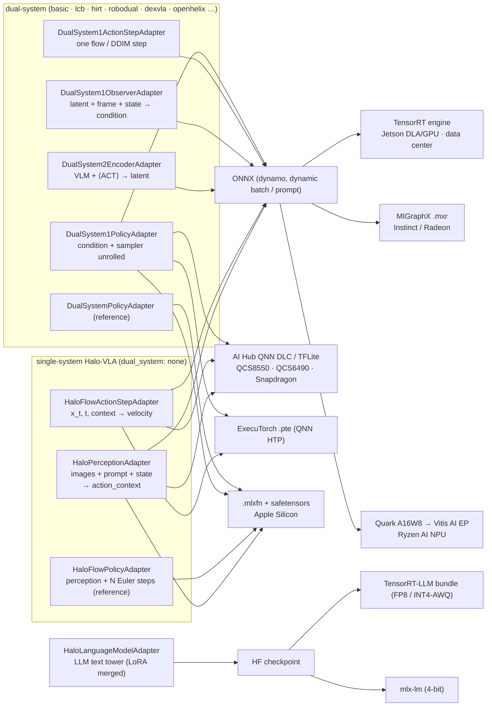
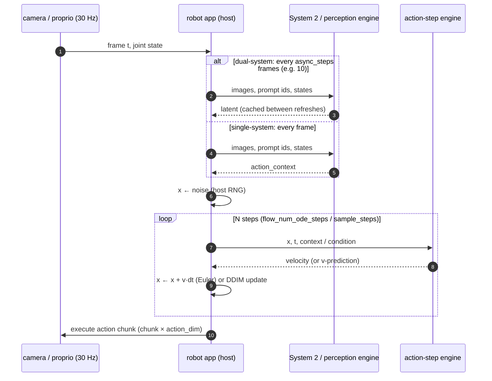
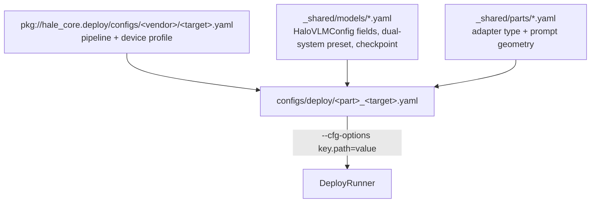

# Deploying Halo-VLA policies (NVIDIA · Apple · AMD · Qualcomm)

Halo-VLA policies are exported with HaleBlocks' deployment framework (`hale_core.deploy`):
YAML configs that inherit packaged vendor pipelines, a model **adapter** that knows which part
of the policy to export, and stages that export, quantize, compile and **numerically validate**
each artifact against PyTorch.

```bash
pip install -e '.[deploy-nvidia]'      # or deploy-apple / deploy-amd / deploy-qualcomm
hale-wam-deploy env                    # which backends this machine can run
hale-wam-deploy list                   # stages, runtimes, adapters (halo_vla.* scope)
hale-wam-deploy run configs/deploy/perception_jetson_orin_dla_fp16.yaml \
    --cfg-options adapter.checkpoint=checkpoints/best.pt
```

Artifacts land in `work_dirs/deploy/<name>/<stage>/`, with `config.yaml` (fully merged),
`manifest.json` (every artifact, size, sha256, lineage) and `report.json` (stage status, timings).

## 1. Why the policy is split

A robot does not run "the VLA" as one function. It runs a heavy perception model at camera rate
and a light action head many times per action chunk; dual-system designs add an even slower
System 2 that refreshes a latent asynchronously (`DualSystemController`). Each part is exported
as its own graph so it can sit on the right accelerator at the right rate.



| adapter (`type: halo_vla.<name>`) | inputs | outputs | runs |
|---|---|---|---|
| `HaloPerceptionAdapter` | `images [B,N,3,H,W]`, `input_ids [B,L]`, `attention_mask [B,L]`, `states [B,S,d]` | `action_context [B,K,emb]` | per camera frame |
| `HaloFlowActionStepAdapter` | `noisy_actions [R,chunk·A]`, `t [R]`, `context [R,emb]` | `velocity` | `flow_num_ode_steps`× per chunk |
| `HaloFlowPolicyAdapter` | observation + `noise [B,K,chunk·A]` | `actions [B,K,chunk,A]` | reference / synchronous |
| `DualSystem2EncoderAdapter` | observation | `latent [B,K,d1]`, `latent_mask` | every `async_steps` |
| `DualSystem1ObserverAdapter` | `latent`, `latent_mask`, `image`, `state` | `condition`, `condition_mask` | per control step |
| `DualSystem1ActionStepAdapter` | `condition`, `condition_mask`, `noisy_actions`, `timestep` | `prediction` | `sample_steps`× per step |
| `DualSystem1PolicyAdapter` | latent + frame + state (+ `noise`) | `actions [B,chunk,A]` | per control step |
| `DualSystemPolicyAdapter` | observation (+ `noise`) | `actions` | reference / synchronous |
| `HaloLanguageModelAdapter` | `input_ids`, `attention_mask` (+ `hf_checkpoint()`) | `logits` | System-2 language |

### Faithful, traceable graphs

The training code is not exportable as is: `HaloVLM._embed_inputs` counts placeholders with
`.item()` and splices states in per-sample Python loops, and the MoE decoder routes tokens with
boolean masks (data-dependent shapes). The deploy graphs (`src/Halo_VLA/deploy/graphs/`) keep
every original weight and re-express only those parts with static shapes:

* `StaticPromptEmbedder` — all frames through the vision encoder in one batched call; `<state>`
  slots filled by a one-hot matmul built from `cumsum` of the placeholder mask.
* `TokenStateSelector` — states at `<halo_action>` positions by one-hot matmul (no `nonzero`).
* `DenseMoE` (`MoEDensifier`) — every routed expert evaluated and gated (unselected gates are
  exactly 0), top-k by iterated `amax` so even the MLX bridge and the QNN HTP lower it.
* Samplers take the **noise as an input**; flow (Euler) and DDIM schedules are unrolled with
  their constants resolved at export time.

`tests/deploy/test_deploy_graph_equivalence.py` checks them against `HaloVLM.forward`,
`sample_actions`, `DualSystemVLA.encode_latent` and `predict_actions` for all seven
dual-system presets plus `middle_layer` (max error ≤ 1e-6).

**Prompt contract.** Perception graphs take the same `input_ids` the dataloaders build
(`<image>`×N, `<state>`, instruction, `<halo_world_video>`×F, `<halo_action>`×K); the number of
frames is `images.shape[1]` and must equal the `<image>` count. `PromptIOSignature` writes these
placeholders into every reference / calibration sample so parity and quantization see real prompts.

## 2. The on-robot control loop



The integrator stays on the host on purpose: step count, solver and early stopping can change
without re-exporting, and the step graph is tiny enough to sit on an NPU/DLA. Use the unrolled
`*Policy` graphs when a single call per control step is simpler (or the accelerator's launch
overhead dominates).

## 3. Targets

| part × target | NVIDIA | Apple | AMD | Qualcomm |
|---|---|---|---|---|
| perception (single) | Jetson Orin DLA FP16, GPU INT8; DC TensorRT | MLX FP16 | MIGraphX FP16 | AI Hub QNN DLC W8A16 (QCS8550) |
| flow action step | TensorRT FP16 (Jetson GPU) | MLX (any) | Ryzen AI NPU A16W8 | AI Hub W8A16 (QCS6490), ExecuTorch 16a8w |
| single policy (unrolled) | TensorRT FP16 | MLX INT4 | MIGraphX FP16 | AI Hub (via configs) |
| System 2 (dual) | TensorRT FP8 (Hopper+) | MLX bridge | MIGraphX | not recommended on mobile NPUs (LLM-sized; run on host or server) |
| System 1 policy (dual) | Jetson Orin DLA/GPU FP16 | MLX FP16 | Ryzen AI NPU A16W8 | AI Hub W8A16 (QCS8550) |
| LLM text tower | TensorRT-LLM FP8 / INT4-AWQ; Thor: TensorRT-Edge-LLM | mlx-lm Q4 | vLLM-ROCm from the HF checkpoint | Genie / AI Hub LLM recipes (`ext_pkgs/ai-hub-models`) |

**Not supported, and why**

* *Pretrained HF vision towers (SigLIP / CLIP) and HF LLMs inside the perception graph* trace
  with `torch.export`, but TensorRT DLA and the QNN HTP reject several of their ops / sizes; use
  the GPU / NPU-float paths and keep `strict: false` checkpoint loading. Validate with
  `RuntimeParityStage` before shipping.
* *Visual DiT head (`enable_visual_dit`)* is a training/world-model head; it is not part of the
  deployed policy (configs set `enable_visual_dit: false`, `strict: false`).
* *LLM servers and the vision prefix*: `HaloLanguageModelAdapter` exports the text tower. Serving
  the spliced image/state prefix needs custom-embedding inputs (TensorRT-LLM multimodal
  embeddings / prompt tables) or the `DualSystem2EncoderAdapter` graph.
* *DLA* runs FP16/INT8 convolutions and matmuls; attention softmax and gathers fall back to the
  GPU (`gpu_fallback: true`). Expect most of a transformer on the GPU — the DLA pays off for
  the convolutional System-1 observer.

## 4. Latency guidance

**Jetson (Orin / Thor).** Build engines *on the device* (engines are GPU-specific; JetPack 6 =
TensorRT 10, JetPack 7 = TensorRT 10.x/11). Put perception / System 2 on the GPU (FP16 or INT8
with ModelOpt Q/DQ), the System-1 observer on DLA, and keep the flow step on the GPU (it is
launch-bound — batch all `<halo_action>` rows in one call, use CUDA graphs in the app). Use
`timing_cache` to make rebuilds seconds instead of minutes. On Thor, FP8/NVFP4 and
TensorRT-Edge-LLM cover the System-2 LLM.

**Snapdragon / QCS (Hexagon NPU).** The HTP compiles **static shapes**: configs export at the
signature's `opt` shapes — choose `opt_seq` = your real prompt length. W8A16 is the accuracy/speed
sweet spot for transformers; INT8 for the conv observer. int64 token ids are truncated to int32
automatically (`--truncate_64bit_io`). Profile on a real device (`profile: true`) and check the
layer placement in `profile.json` — anything on CPU is a latency cliff. Keep System 2 off the NPU
(LLM-sized) and run System 1 at control rate on it.

**Apple Silicon.** FP16 weights by default; INT4 (group 64) for memory-bound policies. `.mlxfn`
holds one trace per exported corner — export the shapes you call with.

**AMD.** MIGraphX compiles for the `opt` shapes ahead of time (minutes of JIT avoided at the first
request). Ryzen AI NPU: Quark A16W8 for transformers; first session creation compiles into
`vitisai_cache`.

## 5. Configs

`configs/deploy/` composes three layers with `_base_`:



* `ci_*` — tiny random-weight models; ONNX Runtime and MLX parity at min / opt / max shapes
  (run in seconds, used by `tests/deploy`).
* `perception_*`, `action_step_*`, `policy_*`, `system1_*`, `system2_*`, `language_model_*` —
  production targets; set `adapter.model` to your trained architecture and `adapter.checkpoint`.
  AI Hub device names (`QCS8550 (Proxy)`, `QCS6490 (Proxy)`) are config values — list yours
  with `qai-hub list-devices`.

## 6. Research notes (October 2026)

* **TensorRT 11** is strongly typed only: `kFP16`/`kINT8`/`kFP8` builder flags and the INT8
  calibrator are gone; precision comes from the ONNX graph via **ModelOpt AutoCast** (FP16/BF16)
  or ModelOpt Q/DQ quantization. The TensorRT stage feature-detects 10 vs 11.
  [migration guide](https://docs.nvidia.com/deeplearning/tensorrt/latest/api/migration/tensorrt-10x-to-11x-c-api-patterns.html) ·
  [ModelOpt changelog](https://nvidia.github.io/Model-Optimizer/reference/0_changelog.html)
* **TensorRT-LLM 1.2** removed the TensorRT engine backend (`trtllm-build`); the PyTorch backend
  serves HF-format (optionally ModelOpt-quantized) checkpoints. [release notes](https://nvidia.github.io/TensorRT-LLM/release-notes.html)
* **TensorRT-Edge-LLM** — NVIDIA's on-device LLM/VLM runtime for Jetson Thor / DRIVE (`ext_pkgs/TensorRT-Edge-LLM`).
* **MLX** `mx.export_function` writes portable `.mlxfn` graphs loadable from Python, C++ and
  Swift; `shapeless` keeps the rank fixed. [export guide](https://www.mintlify.com/ml-explore/mlx/guides/export)
* **ROCm 7.1+** removed ONNX Runtime's ROCm EP; **MIGraphX** (direct or as ORT's MIGraphX EP) is
  the AMD GPU path. [ORT ROCm EP](https://onnxruntime.ai/docs/execution-providers/ROCm-ExecutionProvider.html)
* **Ryzen AI** NPUs run INT8/BF16 ONNX through the Vitis AI EP; **Quark** A16W8 is recommended for
  transformers. [Vitis AI EP](https://onnxruntime.ai/docs/execution-providers/Vitis-AI-ExecutionProvider.html) ·
  [Quark ONNX config](https://quark.docs.amd.com/v0.11.1/onnx/user_guide_config_description.html)
* **Qualcomm AI Hub** deprecated `qnn_context_binary` (Mar 2026) and `precompiled_qnn_onnx`
  (May 2026) as compile targets; context binaries come from `submit_compile_and_link_jobs`.
  Targets today: `tflite`, `qnn_dlc`, `onnx`. [release notes](https://workbench.aihub.qualcomm.com/docs/hub/release_notes.html)
* **ExecuTorch QNN**: `to_edge_transform_and_lower_to_qnn` + `QnnQuantizer` (PT2E), QNN SDK 2.37
  recommended. [backend docs](https://docs.pytorch.org/executorch/1.0/backends-qualcomm.html)

## 7. Testing

```bash
PYTHONPATH=../HaleBlocks/src python -m pytest tests/deploy -q        # unit + integration (ONNX Runtime, MLX)
```
