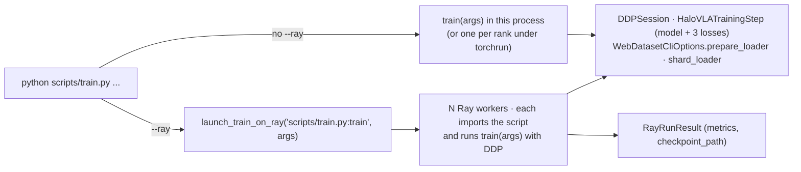

# Distributed training: torchrun, Ray Train and WebDataset

`scripts/train.py` runs unchanged on one process, under `torchrun`, or on a Ray cluster, and can
stream any of its datasets (EO, DROID, AIRoA MoMa) from WebDataset shards. The distributed
runtime lives in `src/Halo_VLA/training/`; Ray and WebDataset come from HaleBlocks
(`hale_core.distributed.ray`, `hale_core.data.webdataset`; design in HaleBlocks'
`docs/distributed_training.md`). Install the optional pieces with `uv sync --extra distributed`
(or `--extra ray` / `--extra webdataset`).



## How one training step is distributed

| piece | file | what it does |
|---|---|---|
| `DDPSession` | `training/ddp_session.py` | joins / creates the process group (NCCL on CUDA, Gloo on CPU), picks `cuda:<local_rank>`, wraps the step in DDP, gives each rank a `DistributedSampler` shard, averages epoch metrics |
| `HaloVLATrainingStep` | `training/training_step.py` | model forward **and** the language, action-flow and visual losses in one `nn.Module.forward` |
| `RayCliOptions` / `launch_train_on_ray` | `training/ray_cli.py`, `training/ray_launch.py` | `--ray*` flags → HaleBlocks `RayConfig` → `TorchTrainer` |
| `WebDatasetCliOptions` | `training/webdataset_cli.py` | `--webdataset*` flags → HaleBlocks `WebDatasetConfig`; swaps the loader's dataset for its shard stream |

Why the training step is a module: `compute_flow_loss` and `compute_visual_prediction_loss` use the
action-decoder and DiT parameters outside `HaloVLM.forward`. DDP only tracks parameters used inside
the wrapped module's `forward`, so the whole step is wrapped (`find_unused_parameters=True` covers
batches without future frames). Single-process runs use the same module, so every mode computes
exactly the same losses.

Only rank 0 logs, writes TensorBoard, renders GIFs and saves checkpoints. Checkpoints hold the
unwrapped `HaloVLM` state dict, so they load the same way whether DDP was used or not. With
gradient accumulation, intermediate micro-steps run under `no_sync()` so gradients are all-reduced
once per optimizer step.

## torchrun

```bash
torchrun --nproc_per_node 4 scripts/train.py --dataset droid --droid_data_root /data/droid_100 \
    --batch_size 4 --epochs 10
```

`--batch_size` is per rank; the effective batch is `batch_size × ranks × grad_accum_steps`.

## Ray Train

```bash
python scripts/train.py --ray --ray_num_workers 8 --ray_use_gpu --ray_cpus_per_worker 8 \
    --ray_address auto --ray_storage_path /shared/ray_results --ray_max_failures 3 ...
```

| flag | default | meaning |
|---|---|---|
| `--ray` | off | launch on Ray Train workers |
| `--ray_address` | local Ray | `auto` or `ray://host:10001` to join a cluster |
| `--ray_num_workers` | `1` | training processes (one per GPU) |
| `--ray_use_gpu` | off | one GPU per worker (NCCL); otherwise CPU workers (Gloo) |
| `--ray_cpus_per_worker` | Ray default | CPUs reserved per worker |
| `--ray_storage_path` | `ray_results` | where Ray persists reported checkpoints (local, NFS, `s3://`) |
| `--ray_max_failures` | `0` | worker-group restarts after a failure |

Workers receive a **reference** to the training function (`"<path>/scripts/train.py:train"`) and
the parsed arguments, and import the script themselves; nothing else from the driver process is
pickled. The repository must therefore be at the same path on every node (one machine, NFS, or a
Ray `runtime_env` `working_dir`). At every epoch end all ranks report their averaged losses; rank
0 attaches the checkpoint directory on save epochs. After a worker failure Ray restarts the group
and `train` resumes from the newest `halo_vla_epoch*.pt` in the restored checkpoint.

## WebDataset

```bash
python scripts/train.py --dataset moma --moma_data_root /data/airoa-moma \
    --webdataset --webdataset_root /fast_disk/shards --webdataset_samples_per_shard 256
```

The first run reads the dataset once (video decoding, parquet parsing, tokenisation) and writes
every collated-ready sample to `<root>/<dataset>-train-<fingerprint>/shard-*.tar` plus a
`manifest.json`; it then streams the shards. Later runs - and every distributed rank - reuse them.
The fingerprint hashes the arguments that change samples (dataset, roots, cameras, frame counts and
strides, sequence / action / state sizes, `--max_samples`); anything else (learning rate, epochs,
loss weights) reuses the same shards. In a distributed run only rank 0 converts; the others wait at
a barrier. With several ranks each rank resamples shards so every rank runs the same number of
steps (required by DDP).

| flag | default | meaning |
|---|---|---|
| `--webdataset` | off | convert + stream |
| `--webdataset_root` | `data/webdataset` | shard root |
| `--webdataset_samples_per_shard` | `256` | samples per tar; keep ≥ ranks × DataLoader workers shards |
| `--webdataset_convert_workers` | `0` | DataLoader workers reading the source while converting |
| `--webdataset_shuffle_buffer` | `1000` | in-memory sample shuffle while training |
| `--webdataset_overwrite` | off | re-convert even if valid shards exist |

## Tests

`tests/test_training_runtime.py` runs the real `train(args)` with a tiny stand-in model and
dataset: single process, resume, `--webdataset` (converts once, reuses), 2-rank DDP over Gloo
(both ranks end with identical weights) and `--ray` with 2 workers (metrics + checkpoint reported).
