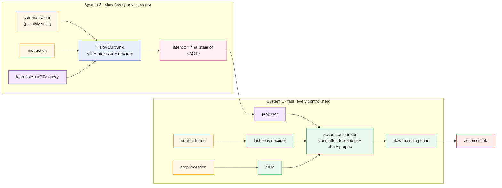
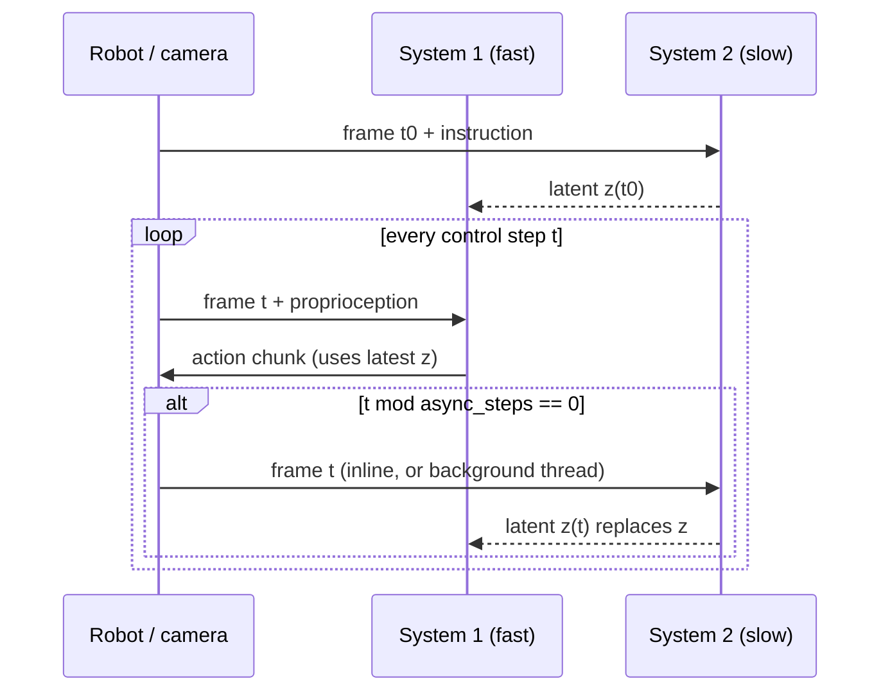
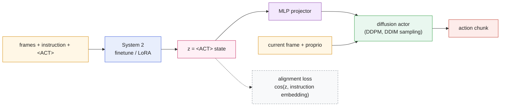
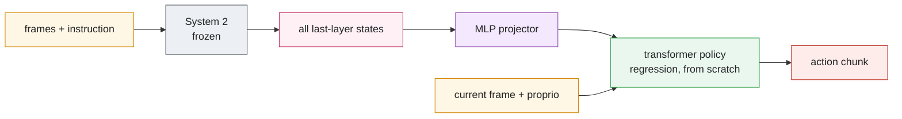
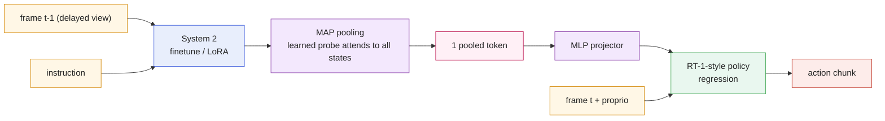
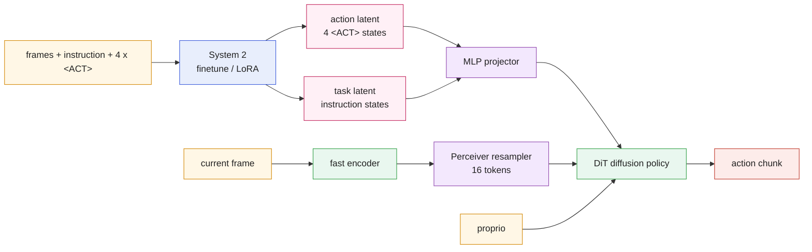
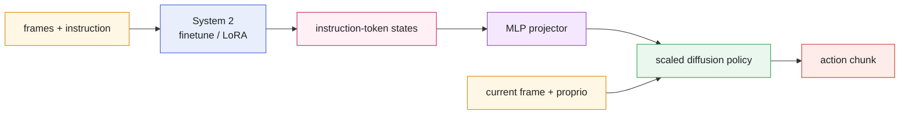
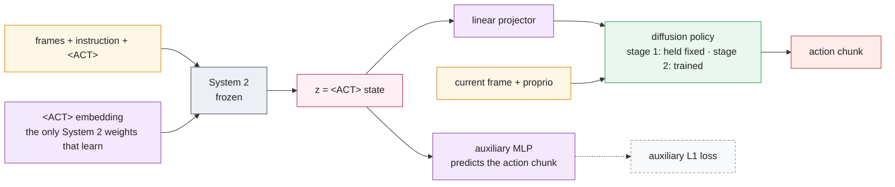
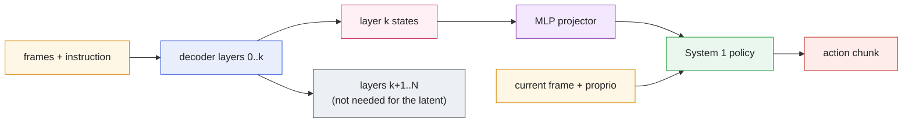

# Dual-system VLA: from first principles to the published variants

`src/Halo_VLA/dual_system/` builds a dual-system vision-language-action model from first
principles, then expresses each published design surveyed by **OpenHelix** (Cui et al., 2025,
[arXiv:2505.03912](https://arxiv.org/abs/2505.03912)) as a configuration of the same parts. It is
selected with one setting, and `none` (the default) keeps the single-system Halo-VLA:

```bash
python scripts/train.py ... --dual_system none        # default: single-system Halo-VLA
python scripts/train.py ... --dual_system basic       # first-principles dual system
python scripts/train.py ... --dual_system openhelix --dual_system_option async_steps=60
python scripts/train.py ... --dual_system custom \
    --dual_system_option latent=pooled --dual_system_option policy=diffusion
```

```python
HaloVLMConfig(dual_system="hirt", dual_system_options={"async_steps": 8})
```

```yaml
# configs/dual_system/<preset>.yaml, or any run config:
model:
  dual_system:
    preset: openhelix             # none | basic | lcb | dp_vla | hirt | robodual | dexvla | openhelix | custom
    async_steps: 60               # any DualSystemConfig field overrides the preset
```

`python scripts/train.py --config configs/dual_system/openhelix.yaml`. Every preset has a
config, and `configs/dual_system/custom_middle_layer.yaml` builds a custom design with a
Qwen3.5 System 2.

## 1. First principles

**The problem.** A large vision-language model reasons well and generalises, but it is slow:
RT-2 runs at 1-5 Hz, while manipulation needs control at tens of Hz. A small visuomotor policy is
fast but brittle to new instructions and scenes.

**Dual-process theory** (Kahneman, 2011) suggests splitting the work:

* **System 2** - slow, deliberate: the vision-language model reads the instruction and the scene
  and produces a *latent* summarising what to do. It updates rarely.
* **System 1** - fast, reactive: a small policy reads the *current* camera frame and the robot's
  proprioception at control rate, conditioned on the latest latent, and outputs actions.

For this to be a real dual system, System 1 must perceive the scene itself (otherwise it can only
replay what System 2 saw), and the two must run at different rates, so the latent System 1
uses is **stale** by up to `async_steps` control steps.

Three questions then define a design:

1. **What crosses the bridge?** The latent: one learned `<ACT>` token's final state, several,
   all hidden states, a pooled summary, only the language states, or a middle layer.
2. **Who learns what?** Is System 2 frozen, prompt-tuned (only `<ACT>` learns) or fine-tuned? Is
   System 1 trained from scratch or loaded pretrained? Is the projector pre-aligned first?
3. **How is the latent kept useful?** An alignment loss to the instruction (LCB), or an auxiliary
   head that forces the latent to predict actions (OpenHelix).

## 2. The building blocks

| part | file | role |
|---|---|---|
| `System2` | `dual_system/system2.py` | Halo-VLA's VLM trunk (`HaloVLM.encode_sequence`) plus learnable `<ACT>` queries appended after the instruction; training mode frozen / prompt tuning / finetune; optional delayed view (`system2_frame_delay`) |
| latent extractors | `dual_system/latent.py` | `act_token`, `multi_act`, `last_hidden`, `pooled` (MAP), `language`, `middle_layer` |
| `LatentBridge` | `dual_system/latent.py` | `linear` / `mlp` projector into System 1, LCB alignment loss, OpenHelix auxiliary action head |
| `System1Policy` | `dual_system/system1.py` | fast conv encoder of the current frame (+ optional Perceiver resampler), proprioception, action transformer cross-attending to `[latent, observation, proprioception]`; head `regression`, `diffusion` (DDPM with v-prediction + DDIM) or `flow_matching` (rectified flow) |
| `DualSystemVLA` | `dual_system/model.py` | assembly, losses, two-stage pre-alignment |
| `DualSystemController` | `dual_system/controller.py` | two-frequency inference (inline or background-thread System 2) |

The appended `<ACT>` queries come last in a causal decoder, so they attend to the whole image and
instruction context and their final states summarise it. Before any training the latent already
changes when the image changes (tested).

### The basic dual system



### Two frequencies at inference



With `DualSystemController(model, threaded=True)` System 2 runs in a background thread and
System 1 never waits for it after the first latent.

## 3. Design axes and presets

| preset | latent | System 2 | System 1 policy | integration | asynchrony |
|---|---|---|---|---|---|
| `none` | - | Halo-VLA single system (its own flow-matching action head) | - | - | - |
| `basic` | 1 `<ACT>` | finetune | flow matching | MLP projector | `async_steps=1` |
| `lcb` | 1 `<ACT>` | finetune (LoRA with an LLM backbone) | diffusion | alignment loss | sync train, `async_steps=10` test |
| `dp_vla` | all last-layer states | frozen | regression transformer | MLP projector | sync |
| `hirt` | MAP-pooled last layer | finetune | regression | MLP projector | System 2 view delayed 1 frame in training, `async_steps=4` |
| `robodual` | 4 `<ACT>` + instruction states | finetune | diffusion (DiT) | Perceiver-resampled obs (16 tokens) | sync |
| `dexvla` | instruction states | finetune | diffusion | MLP projector | sync |
| `openhelix` | 1 `<ACT>` | prompt tuning | diffusion | linear projector, auxiliary action head, 2-stage pre-alignment (2000 steps) | `async_steps=10` |
| `custom` | any | any | any | any | any |

Every field can be overridden on top of a preset (`--dual_system_option KEY=VALUE`, or
`dual_system_options`). The full list is `DualSystemConfig` in `dual_system/config.py`.

### LCB - latent codes as bridges

Shentu et al., 2024, [arXiv:2405.04798](https://arxiv.org/abs/2405.04798). An `<ACT>` token's
final state conditions a diffusion actor. A CLIP-style loss keeps the latent close to the
instruction's meaning while System 2 is fine-tuned. Here the target is System 2's own (detached)
instruction embedding instead of a separate CLIP text encoder.



### DP-VLA - dual-process VLA

Han et al., CoRL 2024. System 2 stays frozen. Its full last-layer vision and language states
condition a transformer policy trained from scratch.



### HiRT - hierarchical robot transformer

Zhang et al., 2024, [arXiv:2410.05273](https://arxiv.org/abs/2410.05273). The last-layer states
are compressed by multi-head attention pooling (MAP) into one token. During training System 2
sees an older frame than System 1 (`system2_frame_delay=1`), which simulates its latency at
deployment.



### RoboDual - synergistic dual system

Bu et al., 2024, [arXiv:2410.08001](https://arxiv.org/abs/2410.08001). Several `<ACT>` tokens
(action latent) plus the instruction states (task latent) condition a DiT diffusion policy. The
policy's observation features are distilled by a Perceiver resampler. The paper also feeds depth,
tactile and proprioception; the Halo-VLA datasets provide RGB and proprioception.



### DexVLA - plug-in diffusion expert

Wen et al., 2025, [arXiv:2502.05855](https://arxiv.org/abs/2502.05855). The language states of
the fine-tuned VLM condition a large diffusion policy.



### OpenHelix - prompt-tuned MLLM with auxiliary action head

Cui et al., 2025, [arXiv:2505.03912](https://arxiv.org/abs/2505.03912). The paper's findings:
- prompt tuning (only `<ACT>` learns) generalises best to new instructions;
- an auxiliary head that predicts actions from the latent makes it carry visual information
  instead of only restating the instruction;
- pre-aligning the projector before joint training is essential.

Stage 1 holds System 1 fixed for `prealign_steps` while the prompt and projector align. Stage 2
trains them jointly.



### Middle-layer latent (custom)

GR00T-N1 (Bjorck et al., 2025, [arXiv:2503.14734](https://arxiv.org/abs/2503.14734)) conditions
its action head on a middle decoder layer, which retains more visual detail and allows cheaper
inference. The survey counts GR00T as single-system; the latent is available for custom designs:
`--dual_system custom --dual_system_option latent=middle_layer`.



## 4. Training and evaluation

* Losses: System 1 policy loss, plus `align_weight` × alignment, `aux_weight` × auxiliary, and
  `lm_weight` × System 2 language modelling (0 by default). In `scripts/train.py` they appear as
  `act` (policy), `lang` (LM) and `vis_sub` (`loss_aux`, `loss_align`).
* System 1 replaces Halo-VLA's own flow-matching and DiT video heads: those are frozen and unused
  in dual-system mode, and training GIFs (which visualise them) are disabled.
* Pre-alignment holds System 1 fixed by dropping its gradients before the optimiser step rather
  than toggling `requires_grad`, so the parameter set DDP registered never changes.
* A pretrained System 1 (OpenHelix's `Policy(P)`) loads with
  `--dual_system_option system1_checkpoint=path.pt`.
* `--val_fraction` validation scores dual-system action chunks the same way
  (`VLAEvaluator` calls `DualSystemVLA.predict_actions`).
* System 2 can be any Halo-VLA configuration: the built-in decoder, or a pretrained LLM backbone
  (`--llm_backbone`, e.g. LoRA-tuned Qwen) for the `finetune` designs.

## 5. Caveats

* The diffusion head predicts the velocity `v` (Salimans & Ho, 2022) rather than the noise `ε`.
  Recovering the action from a noise prediction divides by `√ᾱ`, which is about 0.003 at the
  noisiest level. The first sampling step would then amplify any prediction error about 300×,
  and sampled actions would come out at ±300 until the network is near-perfect. With `v` the
  recovery needs no division, whatever the action scale. The published designs instead normalise
  actions to [-1, 1] and clip.

* This reproduces each design's information flow and training recipe inside one codebase; it does
  not reproduce the papers' models (LLaVA-7B, OpenVLA, 3D Diffuser Actor, …) or their CALVIN
  results.
* LCB's alignment target is System 2's own instruction embedding, not a CLIP text encoder.
* RoboDual's depth and tactile inputs are not modelled (the datasets provide RGB +
  proprioception).

Tests: `tests/test_dual_system.py` covers presets and overrides, every latent type (built-in and
LLM System 2), that the `<ACT>` latent responds to the image, the trainable sets per training mode,
that every preset trains, prompt tuning, the pre-alignment stage, the frame delay, that each policy
head overfits a batch, both controllers, and an end-to-end `scripts/train.py` run.
