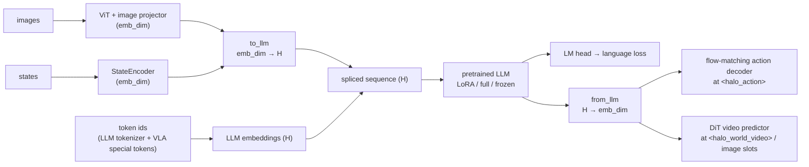

# Pretrained LLM backbone for Halo-VLA

By default Halo-VLA uses its own small decoder (`token_emb` + `DecoderTransformer` + `lm_head`,
512-d, cosmo2 tokenizer). `--llm_backbone <name>` replaces it with any fine-tunable LLM from
HaleBlocks' registry. That covers SmolLM2/3, Qwen2.5/3, Llama 3.x, Gemma 2/3, Phi-3.5/4-mini(-reasoning),
Mistral 7B, Granite 4.2, DeepSeek-R1-Distill and HaloDiffusionLLM causal checkpoints. It also covers the
**text towers of natively multimodal 2026 models**, the usual VLA backbones: Qwen3.5 0.8B/2B/4B (base +
instruct), Gemma 4 E2B/E4B, Ministral 3 3B/8B, Cosmos-Reason2-2B (GR00T N1.7's backbone),
LFM2.5-VL 450M/1.6B/3B and SmolVLM2. The backbone is fine-tuned with LoRA, fully, or kept frozen. The
full list, the selection rule and per-goal picks are in HaleBlocks `docs/llm_backbones.md`.

For a multimodal checkpoint only its decoder and LM head are loaded. Halo-VLA's own vision encoder
(`--vision_encoder`) and projector feed it, so the checkpoint's multimodal pre-training is kept
without its vision tower. Hybrid decoders are supported: Qwen3.5 linear attention, LFM2.5
convolutions and Gemma 4 sliding windows. For Gemma 4, `HaloVLM` passes each position's token id
(the image token for image slots) alongside the spliced embeddings, which Gemma's per-layer
embeddings need. Examples: `configs/examples/llm_qwen3_5_4b_base.yaml`,
`configs/examples/llm_gemma4_e4b.yaml`, `configs/examples/llm_cosmos_reason2_2b.yaml`.
Install with `uv sync --extra finetune`.

```bash
python scripts/train.py --dataset droid --droid_data_root /data/droid_100 \
    --llm_backbone qwen2.5-1.5b --llm_finetune lora --llm_lora_r 16 --llm_lora_alpha 32

python scripts/train.py --llm_backbone hale-autoregressive --llm_checkpoint ckpt/ar/last.pt
```



* **Bridge.** `models/language_decoder.py::PretrainedLanguageDecoder` projects image and state
  embeddings into the LLM width and the final hidden states back to `emb_dim`. The action and
  video heads are unchanged. The LLM supplies its own positions, so the built-in learned position
  table is not created, and neither are `token_emb`, `DecoderTransformer` or `lm_head`.
* **Tokens.** `<image>`, `<halo_action>`, `<state>` and `<halo_world_video>` are added to the
  LLM's tokenizer before fine-tuning is configured. Their ids and the vocabulary size are written
  into `HaloVLMConfig`, and `scripts/train.py` hands that tokenizer to the dataloader, so the
  dataset's ids match the model. The WebDataset fingerprint includes the backbone, so shards are
  rebuilt when the tokenizer changes.
* **Embeddings.** The new special tokens must be learned (`<halo_action>` / `<halo_world_video>`
  keep their embedding in the sequence), so token embeddings and the LM head train by default;
  `--llm_freeze_embeddings` turns that off.
* **Dtype.** The LLM loads in `--llm_dtype` (bfloat16 by default); the bridge and VLA heads stay
  in float32 and inputs / outputs are cast at the boundary.
* **Prompt format.** The datasets build ChatML-style prompts. SmolLM2 and Qwen use ChatML
  natively; other families tokenise those markers as plain text, which works but is not their
  native chat template.

| flag | default | meaning |
|---|---|---|
| `--llm_backbone` | none (built-in decoder) | registered backbone name |
| `--llm_model_id` | registered repo | another repo / local path of the same family |
| `--llm_checkpoint` | — | HaloDiffusionLLM `.pt` for `hale-*` |
| `--llm_finetune` | `lora` | `lora` / `full` / `frozen` |
| `--llm_lora_r`, `--llm_lora_alpha`, `--llm_lora_dropout` | 16, 32, 0.05 | LoRA hyper-parameters |
| `--llm_freeze_embeddings` | off | keep embeddings / LM head frozen |
| `--llm_dtype` | `bfloat16` | weight dtype |
| `--llm_gradient_checkpointing` | off | trade compute for activation memory |

Tests: `tests/test_llm_backbone.py`. It covers token-id rewiring, output shapes, the LoRA /
frozen trainable sets, a full training-step backward, a HaloDiffusionLLM checkpoint backbone, and
the unchanged built-in path. A smoke run with the real `smollm2-135m` (LoRA, embeddings trained)
trains 33.2 M of 139.4 M LLM parameters.
