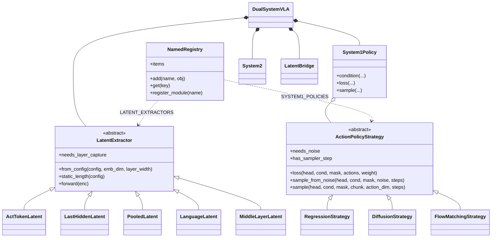
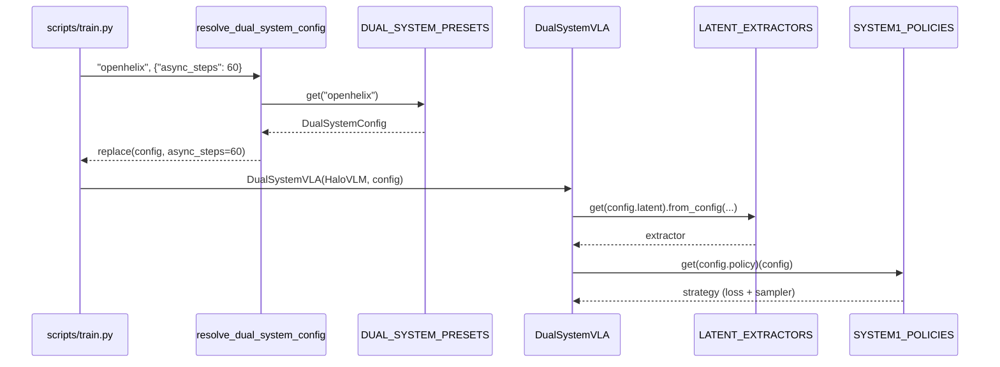

# Registries and extension points

Every choice a user makes by name in a config is a registry lookup, not an `if/elif` chain: to
add an implementation, write one class (or builder) and register it. The registries are
`hale_core.registry.NamedRegistry` instances (mmdet-style: `register_module`, `get`,
`add`, duplicate keys raise, unknown keys list what is registered); Halo-VLA's deploy adapters use a
child `Registry` scoped `halo_vla` under HaleBlocks' `ADAPTERS`.

| Registry | Key (config field) | Module | Register |
|---|---|---|---|
| `DUAL_SYSTEM_PRESETS` | `dual_system` (`--dual_system`, `model.dual_system.preset`) | `dual_system/presets.py` | `register_preset(DualSystemConfig(name=..., ...))` |
| `LATENT_EXTRACTORS` | `DualSystemConfig.latent` | `dual_system/latent/` | `@LATENT_EXTRACTORS.register_module(name="...")` on a `LatentExtractor` subclass |
| `BRIDGE_PROJECTORS` | `DualSystemConfig.projector` | `dual_system/latent/bridge_projector_registry.py` | builder `(in_dim, out_dim) -> nn.Module` |
| `SYSTEM1_POLICIES` | `DualSystemConfig.policy` | `dual_system/system1/` | `@SYSTEM1_POLICIES.register_module(name="...")` on an `ActionPolicyStrategy` subclass |
| `IMAGE_PROJECTORS` | `proj_type` (`--projector_type`) | `models/image_proj/` | builder `(HaloVLMConfig) -> nn.Module` |
| `VISION_ENCODERS` | `vision_encoder` (`--vision_encoder`) | `models/vision_encoders/` | builder `(HaloVLMConfig) -> (nn.Module, VisionEncoderInfo \| None)` |
| `TRAIN_DATASETS` | `--dataset` | `training/train_datasets.py` | builder `(args, HaloVLMConfig, tokenizer) -> DataLoader` |
| `PROFILE_COMPONENTS` | `--component` of `profile_model.py` | `profiling/profile_component_builder.py` | builder `(ProfileComponentBuilder) -> (model, dummy input)` |
| `HALO_VLA_ADAPTERS` | `adapter.type` of a deploy config | `deploy/registry.py` | `@HALO_VLA_ADAPTERS.register_module()` on a `HaloAdapterBase` subclass |

Registration happens on import: each package `__init__` imports the modules that register
(`import dual_system` fills the first four registries).

## Component diagram



## Building a dual-system VLA from a name



## Adding an implementation

```python
from dual_system.latent import LATENT_EXTRACTORS, LatentExtractor


@LATENT_EXTRACTORS.register_module(name="first_text_token")
class FirstTextTokenLatent(LatentExtractor):
    """The state of the first instruction token."""

    def forward(self, enc):
        start = enc["num_prefix"]
        return enc["hidden"][:, start : start + 1], enc["mask"][:, start : start + 1]
```

`DualSystemConfig` validates `latent` against its own `LATENT_TYPES` tuple (the config module
cannot import the registry without a cycle), so a new name also goes into that tuple; the unit
test `tests/unit/test_registries.py` fails when the tuple and the registry disagree.

## Versions and sources

External interfaces used here, and where they are documented:

| Dependency | Constraint (`pyproject.toml`) | Used for | Reference |
|---|---|---|---|
| PyTorch | `>=2.0.0` | models, `scaled_dot_product_attention`, DDP | <https://pytorch.org/docs/stable/> |
| HaleBlocks (`hale_core`) | `hale-blocks` (git) | `HaleCoreError`, `Registry`, `ConfigLoader`, pydantic run-config schemas, deploy framework | `HaleBlocks/docs` |
| loguru | `>=0.7.3` | logging | <https://loguru.readthedocs.io/> |
| transformers / peft | `>=4.30.0` / via `hale-blocks[finetune]` | pretrained LLM and SigLIP / CLIP towers | <https://huggingface.co/docs/transformers> |
| Ray Train, WebDataset | via `hale-blocks[ray,webdataset]` | distributed launch, shard streaming | <https://docs.ray.io/en/latest/train/train.html> |
| ONNX / ONNX Runtime | `>=1.17` / `>=1.20` | deploy graphs and parity checks | <https://onnxruntime.ai/docs/> |

Algorithms re-implemented from papers are cited in the module docstrings: DDPM, DDIM, v-prediction
(Salimans & Ho, 2022), rectified flow (Lipman et al., 2023; Liu et al., 2023), DiT (Peebles &
Xie, 2023), Flamingo gated cross-attention (Alayrac et al., 2022), BLIP-2 Q-Former, DeepSeekMoE,
and the dual-system designs of the OpenHelix survey (Cui et al., 2025, arXiv:2505.03912).
